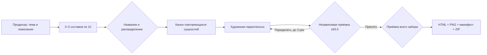

# Как работает

Продюсер задаёт тему, пожелания и количество вариантов. Темы вариантов должны
отличаться содержанием, а не только палитрой. Проект хранит стиль, исходные
референсы и общий канон; каждый заказ получает неизменяемый снимок входов.

Автоматические проверки контролируют формат ответов, количество карточек,
распределение категорий/звёзд, вместимость английских названий, зависимости,
авторство рецензий, лимиты, хеши и формат экспорта. Интересность, материалы,
стиль, анатомию и соответствие пожеланиям оценивает отдельный визуальный
исполнитель. Высокая цифра не отменяет найденного дефекта.

Координатор выдаёт задания, но не держит общую блокировку во время работы
модели. Художники берут независимые карточки параллельно. Петля конкретной
карточки последовательна: картинка → приёмка → точный фидбек → переделка.
Зависимые сценки ждут принятый образ персонажа/предмета. Дефект другого
компонента исходной карточки не блокирует уже квалифицированный канон.

Образы и инварианты сохраняются на уровне набора либо всей коллекции.
Перенос канона между заказами — явная операция `canon-publish`, а не случайное
копирование последнего PNG. Непринятые карточки/наборы видны в отчёте.

По умолчанию используются файловые задания: любой агент может прочитать JSON,
запустить доступный инструмент и вернуть ответ по схеме. Командные/API адаптеры
работают с той же очередью. Веб-режим и CLI используют одно ядро, а не разные
правила. В отчёте есть хронология и Gantt по записанным событиям; длительность
инструмента сохраняется через image-start/image-finish. Они также ограничивают
входы imagegen пятью изображениями и вычисляют хеши без ручного заполнения.
Это интервал отправки/возврата инструмента, а не чистое время вычислений модели.
Подробности: [image-execution.md](image-execution.md).

Первый запуск требует локальные эталоны и реальный доступ к генератору.
Репозиторий содержит процесс и тестовые фикстуры, а не наши исходные материалы
или результаты. Оформление публичной версии нейтральное и не копирует игровые
шрифты/звёзды. При замене оформления повторите проверку подписей.
